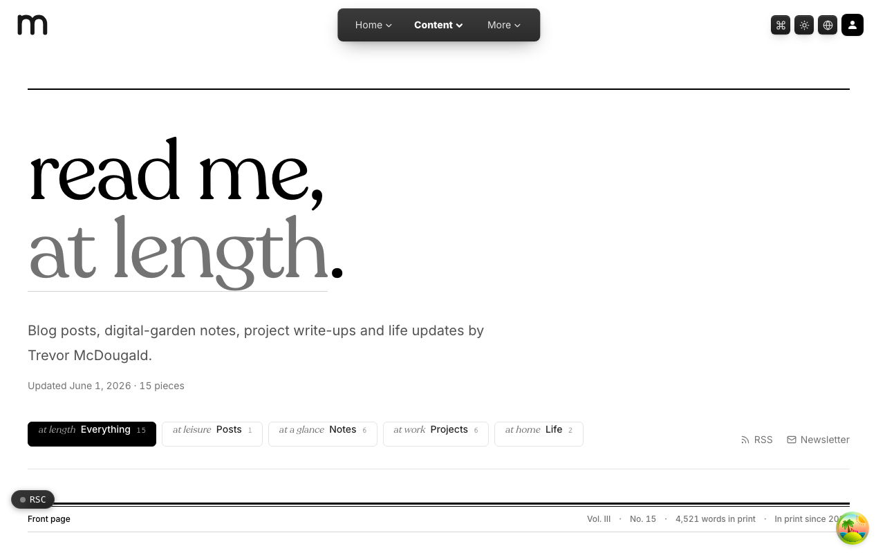
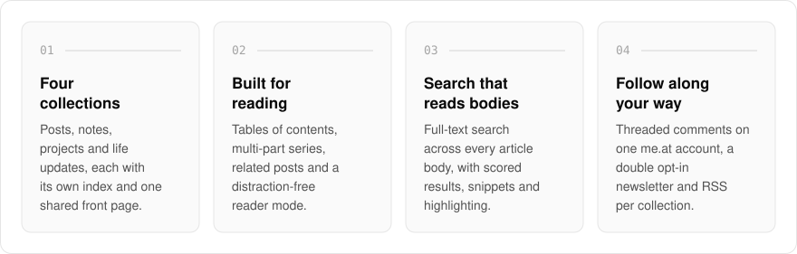
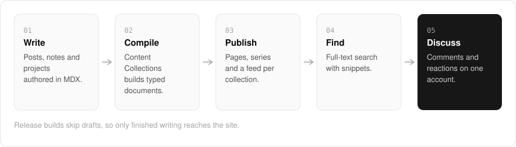
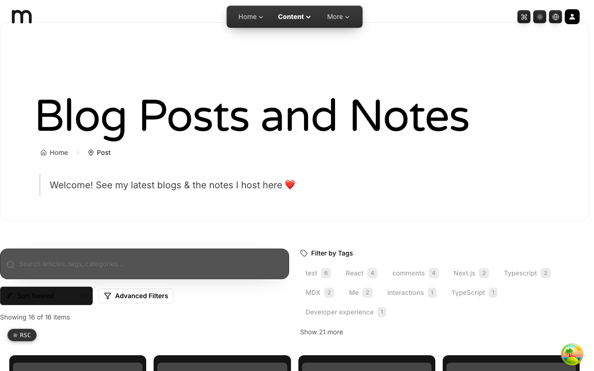
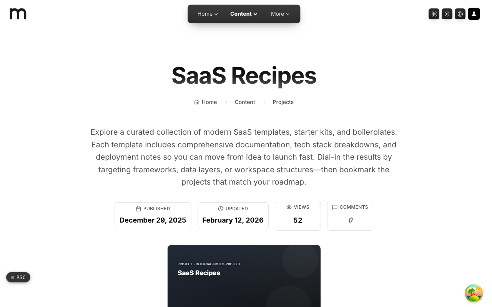
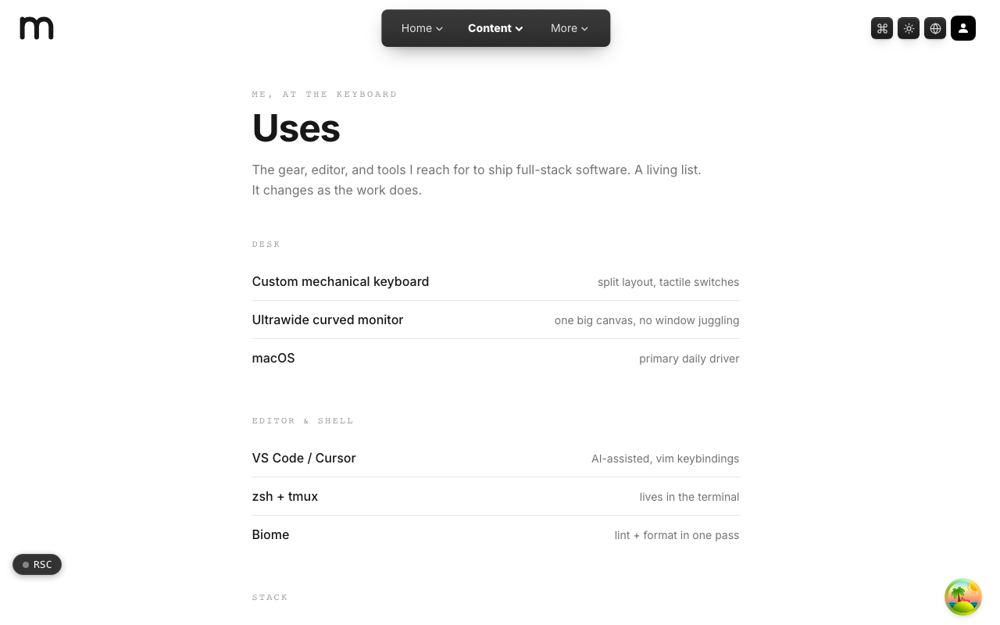

  <picture>
    <source media="(prefers-color-scheme: dark)" srcset=".github/assets/hero-dark.png">
    
  </picture>

<h1 align="center">read.me.at</h1>

<strong>Read me, at length.</strong>

  
  
  

  <a href="https://read.me.at">Website</a> ·
  <a href="#features">Features</a> ·
  <a href="#how-it-works">How it works</a> ·
  <a href="#screenshots">Screenshots</a> ·
  <a href="#built-with">Built with</a>

Writing gets lost when it is scattered across platforms that each own a slice of it. I built read.me.at as the one home for mine: blog posts, digital-garden notes, project write-ups and life updates as a full-stack software engineer working in React, Next.js and modern web technologies. It is made for reading, with full-text search, series and a reader mode, and you can follow along by RSS, newsletter, or comments on one me.at account.

  <picture>
    <source media="(prefers-color-scheme: dark)" srcset=".github/assets/overview-dark.svg">
    
  </picture>

## Why read.me.at

| The usual blog | read.me.at |
| --- | --- |
| Posts only | Posts, notes, projects and life updates, each with its own index |
| Search that matches titles | Full-text search across article bodies, with snippets and highlighting |
| One feed for everything | One feed for everything, plus one per collection |
| Comments through a third-party widget | Threaded comments and reactions on the shared me.at account |

## Features

- **Four collections**: posts, notes, projects and life updates, each with its own index and a unified front page.
- **Article pages**: table of contents, multi-part series, previous and next navigation, and related posts.
- **Full-text search**: search across article bodies, with scored results, snippets and highlighting.
- **Comments and reactions**: threaded comments with reactions and reply notifications, using the shared me.at account.
- **Newsletter**: double opt-in subscribe, confirm and unsubscribe.
- **RSS feeds**: one feed for everything and one per collection.
- **Reader mode**: a distraction-free reading toggle.
- **Uses page**: the gear, editor and tools behind the work.

## How it works

  <picture>
    <source media="(prefers-color-scheme: dark)" srcset=".github/assets/flow-dark.svg">
    
  </picture>

Everything is written in MDX and compiled by Content Collections into typed documents, and release builds skip anything marked as a draft. Each collection gets its own index and feed, search covers article bodies rather than just titles, and comments and reactions use the same account as the rest of the family.

## Screenshots

<table>
  <tr>
    <td width="50%"><picture><source media="(prefers-color-scheme: dark)" srcset=".github/assets/post-dark.png"></picture> Blog posts and notes: search, sort and tag filters.</td>
    <td width="50%"><picture><source media="(prefers-color-scheme: dark)" srcset=".github/assets/notes-dark.png"></picture> Notes: technical notes, quick tips and documentation snippets.</td>
  </tr>
  <tr>
    <td width="50%"><picture><source media="(prefers-color-scheme: dark)" srcset=".github/assets/project-dark.png"></picture> Projects: my project write-ups alongside my public GitHub repositories.</td>
    <td width="50%"><picture><source media="(prefers-color-scheme: dark)" srcset=".github/assets/project--saas-tracking-dark.png"></picture> Project write-up: an article page with its stats.</td>
  </tr>
  <tr>
    <td width="50%"><picture><source media="(prefers-color-scheme: dark)" srcset=".github/assets/uses-dark.png"></picture> Uses: the gear, editor and tools behind the work.</td>
    <td width="50%"></td>
  </tr>
</table>

## Built with

  
  
  
  
  
  

- Next.js 16 (App Router) and React 19
- TypeScript
- Tailwind CSS 4
- MDX compiled with Content Collections
- oRPC and TanStack Query
- Drizzle ORM and Postgres
- Better Auth (shared me.at account)

## Part of the me.at family

read.me.at is one of my [`*.me.at`](https://me.at) apps. They share one design system, account, and app shell. Development happens in a private monorepo; this repository is the project's public-facing home.

## License

Source-available. See [LICENSE](LICENSE).
